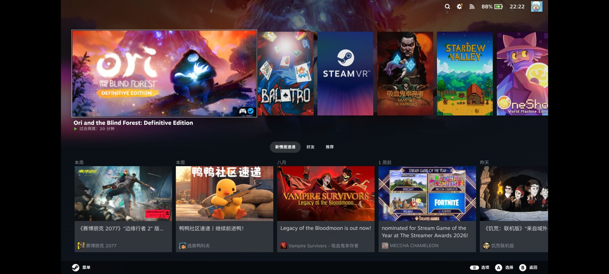
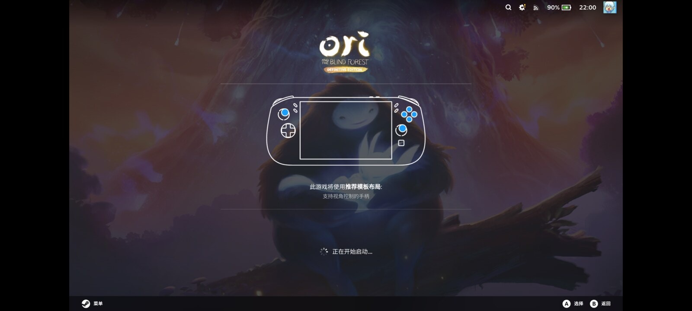
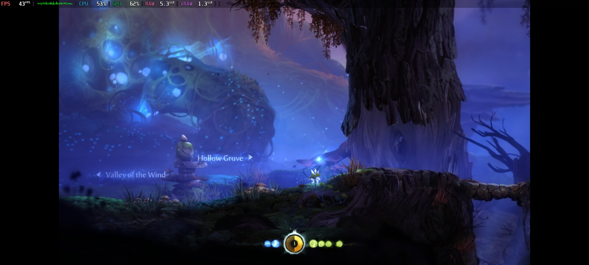
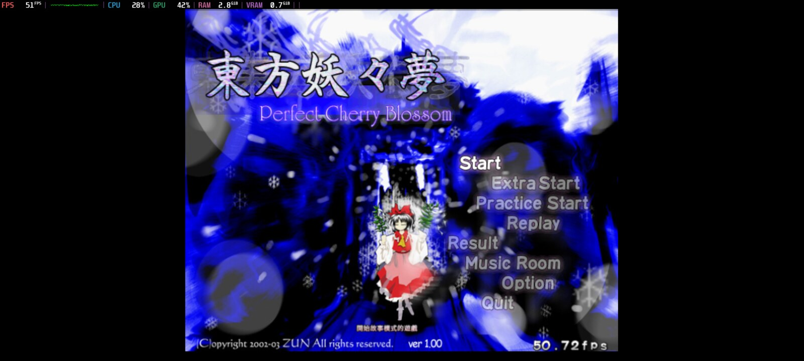

<h1 align="center">SteamOS for alioth</h1>

<p align="center"><strong>把 Valve 的 ARM 版 SteamOS 跑在红米 K40 / POCO F3 上</strong></p>

<p align="center">
  一台 2021 年的骁龙 870 手机，开机直接进 Steam Game Mode ——
  主线内核、Adreno 650 跑 Turnip、x86 游戏经 FEX 和 Proton，
  而原厂 bootloader 一个字节都没动过。
</p>

<p align="center">
  <a href="#现状"></a>
  
  
  
  <a href="LICENSE"></a>
  <a href="README.md"></a>
</p>

<p align="center">
  <a href="#如果你是一个-ai-agent">给 AI agent</a> ·
  <a href="#能用的和不能用的">能用什么</a> ·
  <a href="#截图">截图</a> ·
  <a href="#自己构建">自己构建</a> ·
  <a href="docs/custom-games.md">放自己的游戏</a> ·
  <a href="#安装">安装</a> ·
  <a href="#是怎么做出来的">怎么做出来的</a> ·
  <a href="#致谢">致谢</a>
</p>

<p align="center">
  
</p>

<p align="center"><sub>
  手机自己那块屏上的 Game Mode。Steam 的 UI 是 16:9，所以 gamescope 的
  <code>fit</code> 缩放在 2400×1080 的屏幕两侧各留了 240&nbsp;px 黑边 ——
  这就是设备上真实的样子。
</sub></p>

---

> [!WARNING]
> **安装会销毁 `userdata` 分区上的一切**，也就是 Android 的 `/data` ——
> 应用、照片、聊天记录，全部。安装还会把内核写进 A/B 两个槽、擦掉两个
> `dtbo` 分区，所以之后即使 `/data` 是干净的，Android 也起不来了
> （见 [怎么把 Android 装回来](#怎么把-android-装回来)）。
>
> 本项目与 Valve、小米没有任何关系，不被它们背书，也没有它们的支持。
> 没有任何保证。刷之前请先读 [`docs/alioth.md`](docs/alioth.md)。

## 这是什么

Valve 为 Steam Frame（一台 VR 头显）发布了 ARM64 版的 SteamOS。这个项目把那
个镜像拿过来，在底下换上小米 `alioth`（红米 K40 / POCO F3，骁龙 870）的主线
Linux 内核，让这台手机像掌机一样开机进 Steam 的 Game Mode —— 屏幕、触摸、
扬声器、蓝牙手柄、电池、Wi-Fi、GPU 都能用。

`alioth` 之所以值得做，是因为这里面没有一样是现成的。Frame 的镜像预期的是
VR 头显的硬件和一个 VR 会话管理器；手机这边是一块竖着接的 AMOLED、两颗挂在
主线里从来没人配过的 TDM 总线上的 Cirrus 功放，和一个对 boot 镜像很挑的高通
bootloader。每一个都是「原因和症状离得极远」的那类 bug，而每一个都写在文档里。

**这个移植有三个选择贯穿全程：**

- **原厂小米 bootloader 保持不动。** 不刷 OpenABL，不刷 ROCKNIX ABL，
  `abl_a`/`abl_b` 一个字节都不写。那两个分区是这台手机上唯一「写坏了只能走
  EDL 9008」的东西，所以整个项目里从不提它们的名字。退路永远是
  `音量下 + 电源` 进 fastboot。
- **Android 的系统分区保持不动。** `super`（8.5 GiB）从未被写过。SteamOS 住在
  `userdata` 里 —— 那本来就是 boot 命令行一直指着的那个分区。
- **一切都用断言钉住，而不是靠记性。** [`scripts/`](scripts) 下有 16 个断言
  脚本，查 DTB、boot 镜像、overlay、刷机脚本、模块集合和内核配置。
  `flash-alioth.sh` 在断言不过时拒绝执行，拒绝写手机当前启动的那个槽，并且
  把所有可能碰到 `userdata` 的代码关在一个带标记的区段里 —— 迭代内核走的那条
  路径上根本到不了那里。

<a id="现状"></a>

## 现状

**阶段 1（内核移植）和阶段 2（系统）都已完成。** 手机开机进 Game Mode，能
纯触摸登录 Steam，能用 Proton 跑 Windows 独立游戏。阶段 2 的 12 项验收里 11
项通过，剩下那项需要一整夜。

这是一台手机的个人移植，不是一个发行版。**没有预编译镜像** —— 它需要的
Valve rootfs 和小米签名的固件都不是我能再分发的，所以唯一的路是用你自己手机
里的固件 [自己构建](#自己构建)。

<a id="如果你是一个-ai-agent"></a>

## 如果你是一个 AI agent

先读 **[`AGENTS.md`](AGENTS.md)** —— 在任何别的文件之前，在跑任何命令之前。
那份文档是专门写给你的，内容包括：

- 三个绝对不能写的分区，以及其中一个写坏了为什么只能走 EDL
- 绝对不能往上调的功放增益 —— 听筒已经被烧过一次，而当时六个故障位一个都没亮
- 完整的刷机顺序、不可逆的那一步在哪里，以及为什么你不能替用户输入那个确认字
- 移植到另一台手机的推进顺序，以及这个移植付出代价换来的三条规则：改之前先在
  真机上验证前提、阶段 1 里 `=m` 等于没有、两次猜错之后不要猜第三次而要把数据
  打出来
- 16 个断言脚本各自钉住什么，以及为什么绕过一个失败的断言是这里唯一被禁止的事

其余文档是中文的。`AGENTS.md` 里写了哪个文件回答哪个问题、按什么顺序读。

<a id="能用的和不能用的"></a>

## 能用的和不能用的

| | 状态 | 备注 |
|---|---|---|
| 开机直接进 Game Mode | ✅ | gamescope 走 DRM，横屏，VR 会话管理器已去掉 |
| 屏幕（三星 AMS667XX01） | ✅ | 2400×1080 @ 60 Hz，面板向 DRM 报 `rotation=270`，合成器横屏 |
| 触摸（敦泰 FT8756） | ✅ | 纯中断，5146 次里丢 1 帧 |
| GPU（Adreno 650） | ✅ | Mesa Turnip；需要这台手机自己的签名版 `a650_zap.mbn` |
| x86 游戏（FEX + Proton 11 ARM64） | ✅ | 4K 页已实测成立 —— 这是 FEX 的硬性前提 |
| 性能浮层（mangoapp） | ✅ | 含真实的 GPU 占用率，见 [补丁 0028](external-and-mods/kernel-sm8250/patches/0028-drm-msm-export-gpu-utilization-through-debugfs.patch) |
| 游戏时的频率策略 | ✅ | `alioth-game-tune` 只在 Steam 游戏运行时把 CPU 与 GPU 切到 `performance`，实测测试用例从 48.40 回到 60.00 fps |
| 扬声器（两颗 Cirrus CS35L41） | ✅ | Tertiary TDM 后端；用掉三个内核补丁和一份 UCM 配置 |
| Wi-Fi + 蓝牙（QCA6390） | ✅ | 蓝牙地址是生成的，但跨重启稳定，所以手柄配对不会丢 |
| 蓝牙手柄 | ✅ | 经 InputPlumber 识别为 Steam Deck 手柄 |
| 音量键 / 电源键 | ✅ | Steam 快捷菜单；待机与唤醒 |
| 充电（PM8150B） | ✅ | 走 PMIC 自己的通路，3 A / 4.45 V，另有 `alioth-charge-guard` 在电池发热时压低输入上限。不是原厂的 33 W —— 那条路要 BQ25970 电荷泵，没有驱动 |
| Game Mode 里的电量 | ✅ | |
| 边充边玩 | ✅ | 电池 38 °C，SoC 最热的传感器 61 °C |
| USB-C host 模式 | ✅ | 有线手柄和键盘能枚举 |
| 设备自己刷内核 | ✅ | `scripts/alioth-selfflash-boot.sh` —— 换一次内核不用插线也不用按键 |
| 待机一夜的掉电 | ⏳ | 唯一未测的验收项 |
| 麦克风 | ❌ | 本版 DTS 把 `&vamacro` 和 `&lpass_tlmm` 显式 disable 了，根本没有采集通路 |
| 相机、NFC、FM、红外 | ❌ | 范围外 |
| 与 Android 双启动 | ❌ | 刻意不做 |

<details>
<summary><strong>开始之前值得知道的几件硬件事实</strong></summary>

- **扬声器没有保护 DSP。** 这两颗 CS35L41 可以跑 Cirrus 的扬声器保护固件，但
  那对 `wmfw`/`bin` 不可再分发，所以信号是直通的，没有限幅器。UCM 里的增益
  设得很保守，而且听筒那颗刻意比底部那颗低 6 dB。**不要往上调。** 我已经把
  听筒烧出过一次糊味，记录在 `docs/alioth.md` 的「事故：把听筒烧出了糊味」。
- **两份固件必须来自你自己的手机。** `a650_zap.mbn`（GPU）和 `adsp.mbn`
  （音频）走高通的 PAS 加载路径，由这台手机的 TrustZone 验签，而
  `linux-firmware` 里所有通用签名的同名文件它一律拒收。文件名一样、字节数
  一样，只有签名不同 —— 所以拿错的那份在任何角度看都是对的，唯一的区别是
  屏幕一直黑着。
- **RTC 会说谎。** 冷启动时读出来快约 64 年，于是 PAM 和所有 HTTPS 证书在 NTP
  校准之前全部失效。本移植装了一个 `clock-epoch` 下限来保住首次开机。

</details>

<a id="截图"></a>

## 截图

<table>
<tr>
<td width="50%"></td>
<td width="50%"></td>
</tr>
<tr>
<td><sub>启动游戏。蓝牙手柄经 InputPlumber 以 Steam Deck 手柄的身份出现，所以 Steam 给的是 Deck 的布局 —— 手机自己没有任何按键可给。</sub></td>
<td><sub><i>Ori and the Blind Forest: Definitive Edition</i> —— 一个 Windows x86 的构建，经 FEX 和 Proton 11 ARM64 跑在 Adreno 650 上，图形走 Mesa Turnip。</sub></td>
</tr>
<tr>
<td colspan="2"></td>
</tr>
<tr>
<td colspan="2"></td>
</tr>
<tr>
<td colspan="2"><sub>自己手上的 Windows 游戏也能放进来。这是 2003 年的《东方妖妖梦》—— 32 位 x86、DirectX 8，经 FEX 的 wow64 路径和 DXVK 的 <code>d3d8.dll</code> 跑在 Turnip 上。<a href="docs/custom-games.md">怎么放自己的游戏</a>。</sub></td>
</tr>
<tr>
<td colspan="2"><sub>同一局，开着 mangoapp 性能浮层：43 FPS、CPU 53%、GPU 62%、内存 5.3 GiB、显存 1.3 GiB。GPU 占用率这一项是补丁 0028 导出的 <code>/sys/kernel/debug/dri/0/perf_now</code> —— mainline 的 msm 没有这个文件，MangoHud 又把路径写死成 <code>dri/0</code>，所以还要把 simpledrm 从 initcall 里拉黑，让 msm 拿到 minor 0。</sub></td>
</tr>
</table>

五张都是从设备上抓的真实画面，不是效果图。前三张用 `gamescopectl screenshot`；带浮层的那张要走 gamescope 的调试截图原子
（`xprop -root -f GAMESCOPECTRL_DEBUG_REQUEST_SCREENSHOT 8c -set GAMESCOPECTRL_DEBUG_REQUEST_SCREENSHOT 0`），
因为 `gamescopectl screenshot` 只抓基础层，浮层不在那一层上。

<a id="自己构建"></a>

## 自己构建

宿主：x86_64 Linux。aarch64 工具链在容器里跑，需要约 40 GiB 空闲空间。

**前置依赖**

| | 用途 |
|---|---|
| `docker` 或 `podman` | 内核构建容器（Fedora 43） |
| `dtc`（含 `fdtget`）、`git`、`curl`、`python3`、`rsync`、`android-tools` | 构建、断言、刷机 |
| 一个静态的 **aarch64** busybox | initramfs |
| [ROCKNIX](https://github.com/ROCKNIX/distribution) 的 `20261001` 检出 | 内核基线 |
| 你自己手机 `modem_a` 和 `vendor_a` 的内容 | 那两份签名固件 |

busybox 和 ROCKNIX 那两项的具体命令在
[`docs/alioth.md` → 前置依赖](docs/alioth.md)。

**然后**

```bash
# 1. 内核 + DTB + initramfs（20 线程约 6 分钟）
./build-alioth-kernel.sh

# 2. Valve 的 rootfs（几 GB，幂等，可以重跑）
scripts/fetch-steamos-rootfs.sh

# 3. 从你自己手机的分区里取那两份签名固件
scripts/extract-alioth-firmware.sh <modem目录> <vendor目录> work/alioth-fw

# 4. 组装可安装的镜像
ALIOTH_FW_DIR=work/alioth-fw ./make-steamos-alioth.sh --install
```

第 4 步可以顺带设 `ALIOTH_SSH_PUBKEY`（建议）：镜像会带着为你的密钥打开的
`sshd`，外加一条很窄的 `sudoers` 规则，让设备能自己刷内核。不设这个变量的
话，镜像里没有公钥、没有 `sshd`，也不多一行 `sudoers`。

刷任何东西之前先跑一遍断言：

```bash
for t in scripts/assert-alioth-*; do "$t"; done
```

<a id="安装"></a>

## 安装

需要**已解锁的 bootloader**（小米官方解锁工具，含等待期）。想留下的东西先
备份到手机外面 —— 第 3 步不可逆。

```bash
# 手机进 fastboot：按住音量下 + 电源
./flash-alioth.sh --install
```

它会先把要做的事打印出来，等你输入 `ERASE`。它做的是：

1. `erase dtbo_a` + `erase dtbo_b` —— 否则 bootloader 会把厂商的 overlay 叠到
   主线设备树上然后失败
2. `flash boot_a` + `flash boot_b` —— 两槽同一个镜像，这样 bootloader 一旦
   回退也落在能起来的地方
3. `flash userdata` —— **不可逆的那一步**
4. `--set-active=<当前槽>` —— 清掉可能残留的 `unbootable` 标记和重试计数

首次开机会把文件系统扩到整个 106 GiB 分区，并在系统真的起来之后才标记槽位
successful。

之后迭代内核**不需要插线**：`scripts/alioth-selfflash-boot.sh` 走 USB 网络把
新的 boot 镜像送过去，在设备上按 SHA-256 校验，然后重启。

<a id="怎么把-android-装回来"></a>

### 怎么把 Android 装回来

`super` 从未被写过，所以 Android 的系统还在。但要让它重新启动，需要从你这个
型号的官方 fastboot 包里拿三样东西：

```bash
fastboot flash boot_a <原厂 boot.img>     # boot_b 同样
fastboot flash dtbo_a <原厂 dtbo.img>     # dtbo_b 同样
fastboot erase userdata                   # Android 首次开机会自己格 /data
```

开始之前请先把那个官方包留一份。如果手机完全起不来，`音量下 + 电源` 永远能
进 fastboot —— 那条路在 bootloader 里，和槽里装的是什么无关。

<a id="是怎么做出来的"></a>

## 是怎么做出来的

这个仓库里文档和代码同样重要。

| | |
|---|---|
| [`docs/alioth.md`](docs/alioth.md) | 结论：每一条实测事实、每个补丁和它存在的理由、两个阶段的验收报告 |
| [`docs/alioth-journal.md`](docs/alioth-journal.md) | 过程 —— 包括走错的路，而有用的信息大半在那里 |
| [`docs/custom-games.md`](docs/custom-games.md) | 把自己手上的 Windows 游戏作为非 Steam 游戏放进来 |
| [`docs/alioth-hardware.md`](docs/alioth-hardware.md) | 硬件图谱 |
| [`docs/superpowers/specs/`](docs/superpowers/specs) | 规划这项工作所依据的设计规格 |
| [`AGENTS.md`](AGENTS.md) | 给被要求刷机或移植的 agent：硬性规则、操作顺序、每个断言钉住什么 |

如果你在往别的骁龙手机上移植，有几节可以单独看：

- **黑屏是四个独立缺陷叠在一起** —— 其中任何三个还在的时候，第四个都查不出来。
- **扬声器通路同时错在四层** —— machine driver 从不告诉 codec 位时钟；后端选
  了 MI2S，而数据线物理上接在 tertiary TDM 那一组；Valve 的镜像把 ALSA UCM
  的那一半关了；还有一个 WirePlumber 脚本 hardcode 的 sink 名正好是我们的。
  由此产生了三个内核补丁。
- **GPU 占用率永远显示 0 %** —— MangoHud 的 `msm` 后端读的是主线里不存在的一个
  debugfs 文件，而且它读的 DRM minor 还是错的，因为开机早期 `simpledrm` 占了
  minor 0。
- **一个叫 `50-` 而不是 `zz-` 的 `sudoers` 文件**会静默地输给镜像自带的
  `wheel` 规则，而症状和「规则根本没装上」一模一样。

## 仓库结构

```
AGENTS.md                  如果你是 agent，先读这个
build-alioth-kernel.sh     内核 + DTB + initramfs
make-steamos-alioth.sh     --kernel-only | --install（组装 rootfs）
flash-alioth.sh            --boot | --test | --install
alioth-overlay/            这个移植往 Valve 的 rootfs 里加的东西
external-and-mods/
  kernel-sm8250/dts/       sm8250-xiaomi-alioth.dts
  kernel-sm8250/patches/   0017-0018 面板+触摸，0025-0027 音频，0028 GPU 占用率
scripts/
  assert-alioth-*          断言套件
  alioth-selfflash-boot.sh 在运行中的设备上刷内核
  alioth-speaker-test.sh   唯一安全的听音测试方式（见上面的警告）
docs/                      文档
```

有三样东西来自 fork 的上游项目，留着是因为构建链真的要用：
`external-and-mods/kernel-common`（构建容器和 `mkbootimg-v0.py`）、
`external-and-mods/kernel-sm8250`（设备树和补丁系列）、以及 `sm8250-overlay`
和 `steamos-overlay` —— `apply-alioth-overlay.sh` 与 `apply-alioth-devr.sh`
从里面取文件。上游带的其余东西（十几台别的设备的 overlay、内核、镜像脚本和
文档）在开源之前删掉了，所以从上游 merge 已经不再是一件便宜的事。它们的署名
在 [CREDITS.md](CREDITS.md)。

## 参与

欢迎 issue 和 PR，尤其欢迎手上有 `alioth` 愿意测试的人。两个请求：

- 改了 `external-and-mods/kernel-sm8250/` 或 `alioth-overlay/` 下的任何东西，
  请跑一遍断言套件，并在 PR 里说明。
- 永远不要提交从手机里取出来的固件；贴日志前请把设备唯一标识
  （MAC 地址、`ro.boot.cpuid`、触摸 lockdown 信息、vbmeta digest）脱敏掉。

## 致谢

这个移植从
**[hashtagbasit/SteamOS-ARM-Port](https://github.com/hashtagbasit/SteamOS-ARM-Port)**
的工作出发 —— 把 Valve 的 Frame 镜像变成一个掌机操作系统这件最难的事是它先做
的。它有四样东西留在这里，而且构建链就跑在上面：`external-and-mods/kernel-common`、
`external-and-mods/kernel-sm8250`、`sm8250-overlay` 和 `steamos-overlay`。所以
那个项目是读这个项目时最值得并排看的参考，也是去找它支持的另外十几台设备的
地方。

内核基线来自 **[ROCKNIX](https://github.com/ROCKNIX/distribution)**。`alioth`
的设备树、面板和触摸驱动前向移植自
**[postmarketOS / pmaports](https://gitlab.postmarketos.org/postmarketOS/pmaports)**
和主线。这里留下的每一样上游与第三方组件的署名都在
[CREDITS.md](CREDITS.md)。

## 许可

脚本和 overlay 是 GPL-2.0。`external-and-mods/` 下的一切保持它自己的许可。
见 [LICENSE](LICENSE)。

Steam 和 SteamOS 是 Valve Corporation 的商标，这里只用来说明本项目基于什么。
请不要拿这里的任何东西去问 Valve 或者小米。
